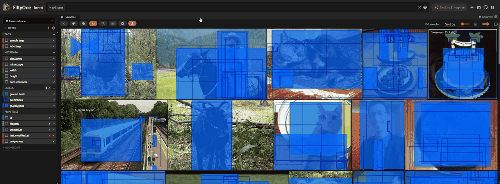

# boxlint

A [FiftyOne](https://docs.voxel51.com) plugin that lints your object detection and polygon labels:
it finds labels that break structural rules (degenerate or out-of-bounds boxes, broken polygons,
duplicates, unknown classes, and more), tags them `issue:<check>`, and shows a summary. No model
needed. It never deletes labels or changes their geometry; it only adds tags.

Bad labels rarely fail where they were made. Depending on your training framework, they crash
training (torchvision), turn the loss into NaN (MMDetection), or are silently dropped along with
their whole image (Ultralytics YOLO). This plugin catches structural problems early, in the App or
from Python, before they cost you a training run.



## In plain terms

### Why this exists

To teach a computer to find objects in images (cars, people, products on a shelf, defects on a
production line), teams show it thousands of examples where a person drew a box or an outline
around each object. Those drawings are the *labels*, and a model can only be as good as its
labels.

Labels get damaged on their way to training. Different people and outside vendors draw them,
tools convert them between file formats, images get resized and cropped, and datasets get merged.
Along the way a box can end up with no size, half outside the picture, drawn twice, or an outline
can cross over itself. Nobody notices, because to a person a label is just a row of numbers in a
file.

### What it solves

Broken labels cause trouble far from where they started:

- Training **crashes**, sometimes hours into an expensive run.
- Training software **quietly throws the image away**, so you train on less data than you paid
  for and never find out.
- The model **learns from wrong examples**, and its accuracy numbers become misleading.

Tracking down the cause usually means someone digging through files by hand. FiftyOne, a tool
many teams use to browse and curate image data, stores these broken labels without complaint and
has no built-in check for them.

### How it solves it

Think of boxlint as a spell-checker for labels. It reads every label and checks it against simple
rules any person would agree with:

- A box must have a real size and sit inside the picture.
- The same object should not be drawn twice.
- An outline must be a proper shape that does not cross itself.
- The object's name must be on your list of allowed names.

Every label that breaks a rule gets a tag naming the problem, and a summary shows how many of
each kind were found. **Errors** are definitely broken; **warnings** are unusual and worth a
look (a tiny box may be a person far in the distance). boxlint never changes or deletes
anything: a person decides what to fix.

It needs no AI model, so it works on day one, before anything has been trained. It gives the same
answer every time on the same data, so it can run as an automatic check. And it is fast: a few
thousand images take about a second.

### Where it helps

- **Accepting labels from a vendor.** Check a delivery before you sign it off, and send back an
  exact list of broken labels instead of a vague complaint.
- **Converting or merging datasets.** Catch boxes broken by a format conversion (for example
  pixel coordinates stored where fractions were expected) before they spread.
- **Before an expensive training run.** Spend a minute checking instead of losing hours of GPU
  time to a crash, or to images silently dropped.
- **Automated data pipelines.** From Python, boxlint can stop a dataset from reaching training
  when it has errors, the way a failing test stops broken code from shipping.
- **Cleaning up an existing dataset.** Start with the labels that are definitely broken, instead
  of reviewing everything by eye.
- **Alongside model-based review.** Once you have a model, the FiftyOne Brain can point out
  labels whose *meaning* is probably wrong (a cat labeled "dog"). boxlint finds labels whose
  *form* is broken. They catch different problems.

What it does not do: it will not tell you that a cat is labeled "dog", or that a box is a little
too loose. And well-curated public datasets usually come out nearly clean; the value is mostly in
your own, converted, merged, and vendor-labeled data.

## What it checks

| Check | Tag | Severity | Flags | Default |
|---|---|---|---|---|
| Degenerate | `issue:degenerate` | error | Box width or height <= 0, or any NaN/inf coordinate | on |
| Out of bounds | `issue:out_of_bounds` | error | Any box edge outside the image by more than a tolerance | on, tolerance 0.001 |
| Tiny | `issue:tiny` | warning | Box pixel area below a minimum | on, 16 px area |
| Aspect ratio | `issue:aspect_ratio` | warning | Box pixel width / height outside `[1/max, max]` | on, max 20 |
| Duplicate | `issue:duplicate` | warning | Same-class boxes on one image with IoU above a threshold | on, IoU 0.95 |
| Unknown class | `issue:unknown_class` | error | Class not in your allowed list (exact, case-sensitive) | off until you give a list |
| Bad polygon | `issue:bad_polygon` | error | Fewer than 3 points, zero area, or self-intersecting | on (Polylines fields) |

**Errors** break a hard or declared rule. **Warnings** are unusual and worth a look, but not
necessarily wrong: a 3 px person far in the background is tiny and still correct.

Rules worth knowing:

- **One problem, one tag.** A NaN or zero-width box is tagged `degenerate` only; the other checks
  skip it.
- **Thresholds are strict.** A box of exactly 16 px area, or exactly 20:1, is not flagged.
- **Tiny and aspect ratio work in pixels**, so they need image width/height. If metadata is
  missing, the form offers to compute it; if you decline, those samples are skipped and the
  output says how many.
- **Duplicates keep exactly one label per group.** Labels are ranked by confidence (missing
  confidence last, ties by order), and a label is tagged if it overlaps an already-kept
  same-class label above the threshold. In a pair, the lower-confidence (or later) one is tagged,
  never both.
- **Only polygons are judged.** A polyline with `closed` and `filled` both off is an open line
  (a lane marking, a skeleton) and is skipped.
- **Unknown class** runs only when you give an allowed-class list. The form pre-fills it from
  `dataset.classes[field]` or `dataset.default_classes` if your dataset declares them.

## Install

```shell
fiftyone plugins download https://github.com/tharanathrai/boxlint
fiftyone plugins requirements @tharanathrai/boxlint --install
```

The only extra dependency is `shapely`, for the polygon check.

## Usage in the App

1. Launch the App with a dataset that has a Detections or Polylines field.
2. Press the backtick key (`` ` ``) and choose **Check labels**.
3. Pick the target (dataset or current view) and the label field, choose checks and thresholds,
   and run.
4. Read the summary table: flagged labels and samples per check, severity, and top classes.
5. In the sidebar, expand **label tags** and select an `issue:*` tag to see the flagged labels.

Every run first clears the field's previous `issue:*` tags (you can turn this off), so the tags
always reflect the latest run. Other tags, such as your own `reviewed`, are never touched.
**Clear issue tags** removes all `issue:*` tags from one field or every field.

### Running in the background (delegated)

For large datasets, **Check labels** can run as a delegated operation. In open-source FiftyOne,
the App's **Schedule** option is only available when
[`allow_legacy_orchestrators`](https://docs.voxel51.com/user_guide/config.html) is on and a
delegated service is running:

```shell
export FIFTYONE_ALLOW_LEGACY_ORCHESTRATORS=true
fiftyone app launch            # terminal 1; start this first
fiftyone delegated launch      # terminal 2; once the App is up
```

A scheduled run shows no result screen: refresh the browser to see the new tags, and read the
summary with `fiftyone delegated output <operation-id>` (ids from `fiftyone delegated list`).

## Usage from Python

The same engine runs from Python and returns a JSON-serializable report, so you can check labels
in a script or gate a dataset import:

```python
import fiftyone as fo
import fiftyone.operators as foo

dataset = fo.load_dataset("my-dataset")
op = foo.get_operator("@tharanathrai/boxlint/check_labels")

report = op.run_checks(
    dataset,                      # or any view
    "ground_truth",
    allowed_classes=["car", "person", "bicycle"],
    tag=False,                    # dry run: compute findings, write no tags
)

print(report["num_error_labels"], "labels with errors")
for check, result in report["checks"].items():
    print(check, result["severity"], result["num_labels"], result["top_classes"])

if report["num_error_labels"]:
    raise SystemExit("label errors found")
```

Options (all optional): `checks` (list of check IDs; default is every check for the field type),
`oob_tol`, `min_area_px`, `max_ratio`, `iou_thresh`, `allowed_classes` (list or comma-separated
string), `compute_metadata` (default True; writes `sample.metadata`, never labels),
`clear_previous` (default True), `tag` (default True).

Bad inputs (unknown field or check, invalid threshold) raise `ValueError` before anything is
written. Each entry in `report["checks"]` has `severity`, `tag`, `num_labels`, `num_samples`,
`class_counts`, `top_classes`, and `label_ids` (plus `reason_counts` for polygons). Use
`dataset.select_labels(ids=result["label_ids"])` to view them.

## Complements the Brain and the duplicate recipe

The FiftyOne Brain's
[mistakenness](https://docs.voxel51.com/api/fiftyone.brain.html) uses a model's predictions to
score how likely each label is wrong: wrong class, poorly localized, missing, or spurious. It
needs a trained model and gives probabilities. This plugin needs no model and reports rule
violations, with the same answer on every run. Use both: boxlint first, to clear out broken
labels, then mistakenness.

FiftyOne's [duplicate objects recipe](https://docs.voxel51.com/recipes/remove_duplicate_annos.html)
uses `compute_max_ious` and `find_duplicates`. By default `find_duplicates` compares boxes across
classes with an IoU threshold of 0.999, and with `method="simple"` it marks the later label of
each overlapping pair. This plugin uses the same IoU (tested against `compute_bbox_iou`), but
compares same-class boxes only at IoU 0.95, tags the lower-confidence label, always keeps one
label per group, and skips degenerate boxes.

## What to expect on clean data

On the `quickstart` zoo dataset (COCO images and labels) with default settings:

| Field | Labels | Degenerate | Out of bounds | Tiny | Aspect ratio | Duplicate |
|---|---|---|---|---|---|---|
| `ground_truth` | 1,232 | 0 | 0 | 11 | 2 | 0 |
| `predictions` | 5,620 | 0 | 0 | 23 | 1 | 0 |

The tiny ground-truth boxes are distant people, birds, a kite, and a boat, 2 to 4 px a side. Of
the two aspect-ratio flags, one is a COCO crowd box (`iscrowd: 1`) drawn as a thin strip over a
row of surfers, a real problem; the other is a train seen side-on.

Curated benchmarks like COCO are expected to come out nearly clean of hard errors. Degenerate and
out-of-bounds boxes show up mostly in custom, converted, merged, and vendor-labeled data.

Speed: 3,000 samples with 18,585 boxes check and tag in about half a second.

## Limitations

- Tested with FiftyOne 1.22.1.
- Top-level Detections and Polylines fields of image datasets only; no video frame fields, no
  nested fields.
- Unknown class applies to Detections only. Class names in the comma-separated input cannot
  contain commas (use the Python API with a list instead).
- Duplicates are compared within a single sample only, and only within the same class: one
  object labeled as both `chair` and `couch` is not flagged.
- It finds structural problems, not semantic ones.

## Development

```shell
python -m venv .venv
.venv/bin/pip install fiftyone pytest shapely
.venv/bin/pytest tests/
ln -s "$PWD" ~/fiftyone/__plugins__/boxlint   # dev install
fiftyone plugins list
```

`checks.py` holds one small pure function per check (no FiftyOne imports). `engine.py` runs them
on a collection and builds the report. `__init__.py` holds the two operators.

## License

Apache 2.0. See [LICENSE](LICENSE).
